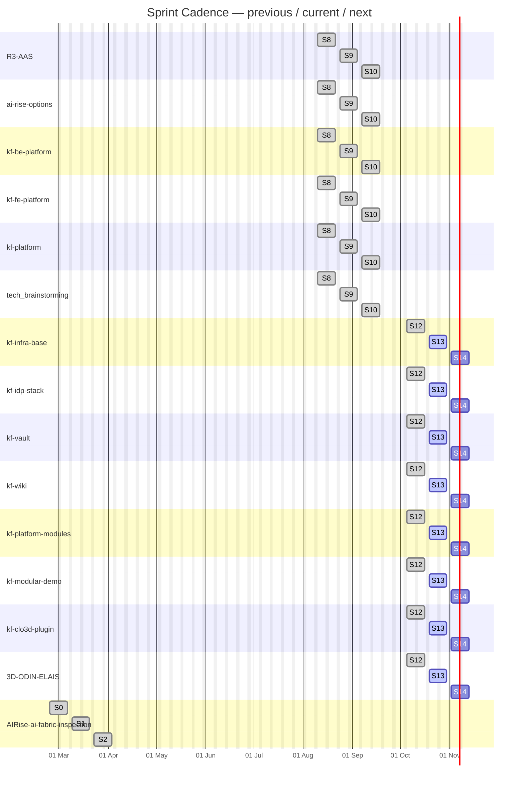
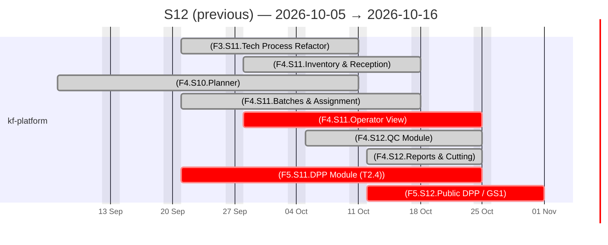
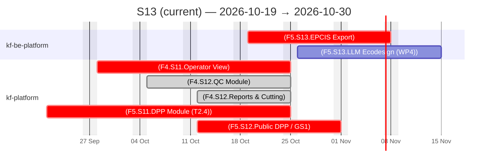
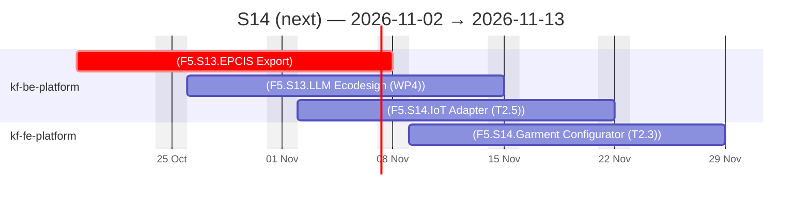

# KF Team — Agile Sprints

## Sprint Timeline

> Previous · current · next sprint per project (from each repo's declared sprint)

PlannedIn workLate / At riskDone

## Sprint Views — previous / current / next

### Sprint S12 (previous) — 2026-10-05 → 2026-10-16

PlannedIn workLate / At riskDone

### Sprint S13 (current) — 2026-10-19 → 2026-10-30

PlannedIn workLate / At riskDone

### Sprint S14 (next) — 2026-11-02 → 2026-11-13

PlannedIn workLate / At riskDone

## Sprint Summary

| Project | Sprint | Window | Total Effort | % Done |
| :--- | :--- | :--- | :---: | :---: |
| R3-AAS | S9 | 2026-08-24 → 2026-09-04 | 52.5d | 84.8% |
| ai-rise-options | S9 | 2026-08-24 → 2026-09-04 | 0d | 0% |
| kf-be-platform | S9 | 2026-08-24 → 2026-09-04 | 77.0d | 54.5% |
| kf-fe-platform | S9 | 2026-08-24 → 2026-09-04 | 62.0d | 83.9% |
| kf-platform | S9 | 2026-08-24 → 2026-09-04 | 167.0d | 58.1% |
| tech_brainstorming | S9 | 2026-08-24 → 2026-09-04 | 0d | 0% |
| kf-infra-base | S13 | 2026-10-19 → 2026-10-30 | 0d | 0% |
| kf-idp-stack | S13 | 2026-10-19 → 2026-10-30 | 0d | 0% |
| kf-vault | S13 | 2026-10-19 → 2026-10-30 | 0d | 0% |
| kf-wiki | S13 | 2026-10-19 → 2026-10-30 | 0d | 0% |
| kf-platform-modules | S13 | 2026-10-19 → 2026-10-30 | 0d | 0% |
| kf-modular-demo | S13 | 2026-10-19 → 2026-10-30 | 0d | 0% |
| kf-clo3d-plugin | S13 | 2026-10-19 → 2026-10-30 | 0d | 0% |
| 3D-ODIN-ELAIS | S13 | 2026-10-19 → 2026-10-30 | 0d | 0% |
| AIRise-ai-fabric-inspection | S1 | 2026-03-09 → 2026-03-20 | 38.0d | 5.3% |
| **TOTAL** | | | **396.5d** | **59.9%** |